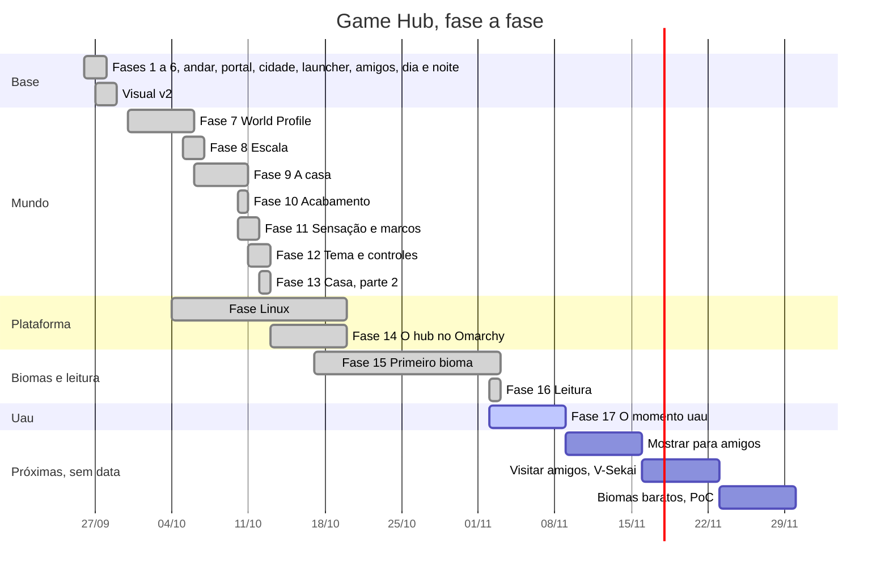

# Game Hub: início

O painel do cofre. Daqui se chega a tudo o que organiza o projeto.

**Painel visual, ao vivo:** com o Docker aberto, `docker compose -f painel/compose.yaml up -d` na pasta do projeto e abra http://localhost:4170 ([como funciona](../painel/README.md)).

## Agora
- **Fase em aprovação:** [Fase 17, O momento uau](plans/fase-17.md), na branch `fase-17`: **implementada**, falta a sua aprovação e o merge na `main`. As capturas de antes e depois ficam em `C:\Projetos\game-hub-referencias\uau\` (fora do repositório).
  - **Última subetapa feita:** 17.10, as três partes (2026-11-08). As pendências da 17.8: a torre do RPG agora é de pedra (com cornija em degraus e portal nas duas faces), a madeira do deque ficou acinzentada e fosca e a cinza da fogueira escureceu e encolheu. O estudo do tranco de ~87 ms: é compilação de shader uma vez por abertura, e a decisão foi aceitar (os números estão no plano). O fechamento: bateria `TUDO OK`, medida no desktop (200 jogos, Alta: 144,8 FPS na caminhada, p99 13 ms) e a folha `folha_17.10.png`. Antes, a 17.9.2 (o acabamento da cabana), aprovada em 2026-11-08.
  - **Próxima:** a sua aprovação da Fase 17 (as capturas e a folha) e, depois, o merge na `main`.
- **Próxima fase:** [Mostrar para amigos](ROADMAP.md#2-mostrar-para-amigos).
- **Para fazer num dia só:** [Dia de conferência no desktop](plans/conferencia-desktop.md).
- **Última fase feita:** [Fase 16, Leitura](plans/fase-16.md), já na `main` (PR #2).
- **Decidido em 2026-11-02:** a [revisão da ROADMAP](revisao-roadmap-2026-11-02.md#decisões) e a [revisão de design](design/revisao-2026-11-02.md).

## O que falta
Lista montada sozinha pelo plugin **Tasks**: junta os `- [ ]` abertos dos planos. Clique no nome do arquivo para abrir. Sem o plugin, aparece só o texto da consulta: para instalar, Configurações › Plugins da comunidade › Procurar › "Tasks" › Instalar e Ativar.

**Nas fases**
```tasks
not done
path includes plans/fase-
description does not include ~~
group by filename
short mode
```

**No dia de conferência**
```tasks
not done
path includes plans/conferencia-desktop
short mode
```

## Linha do tempo
Datas tiradas dos commits. As próximas fases ainda não têm data: ali o tamanho das barras só mostra a ordem.


Ao fechar uma fase, troque `active` por `done` e acerte a data do fim. A fase que começar ganha uma linha com a data de início e sai de "Próximas".

## Rumo
- [ROADMAP](ROADMAP.md): para onde o projeto vai e em que ordem (a fonte única).
- [Ideias](ideias/README.md): a caixa de entrada, com a tabela [ideias.base](ideias/ideias.base).
- [Planos das fases](plans/README.md): um plano por fase, que também é a memória entre as sessões dos agentes.

## Referência
- [Plataforma](PLATAFORMA.md): Steam, Windows e Linux.
- Design: [storyboard](design/storyboard-brief.md), [revisão de 2026-11-02](design/revisao-2026-11-02.md), [revisão de 2026-10-10](design/revisao-2026-10-10.md), [bioma montanha](design/bioma-montanha.md), [addons](design/addons-2026-10-13.md), [exploração open source](design/exploracao-open-source-2026-10-15.md).

## Regras do cofre
1. **Ideia nova vai para `ideias/`**, com o modelo "ideia". Ideia não é tarefa: só vira trabalho quando entra na ROADMAP como fase.
2. **Não edite `plans/` de uma fase em andamento:** os agentes marcam os `[x]` lá.
3. **Imagem colada vai para `_anexos/`**, que fica fora do git. Capa de jogo nunca entra no repositório (ele é público).
4. **Links no formato `[texto](arquivo.md)`**, que já é o padrão deste cofre: assim eles funcionam no GitHub e para os agentes.
