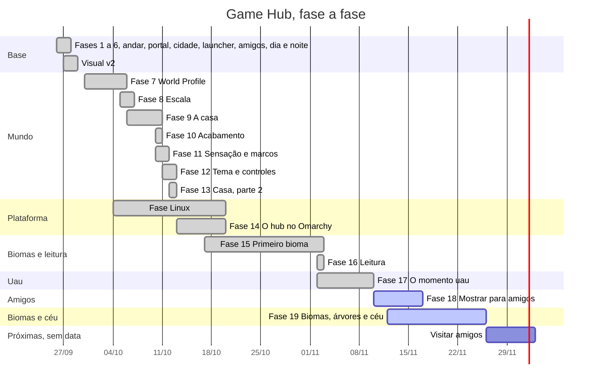

# Game Hub: início

O painel do cofre. Daqui se chega a tudo o que organiza o projeto.

**Painel visual, ao vivo:** com o Docker aberto, `docker compose -f painel/compose.yaml up -d` na pasta do projeto e abra http://localhost:4170 ([como funciona](../painel/README.md)).

## Agora
- **Fase atual:** [Fase 19, Biomas baratos, árvores e céu vivo](plans/fase-19.md), na branch `fase-19`: árvores feitas no Blender, o dia em gradiente, clima dinâmico com a chuva refeita, a floresta e o deserto, e os bairros crescendo com as horas.
  - **Última subetapa feita:** 19.8 (2026-11-15, `b3dbf33`): a Sobrevivência vira deserto. Areia no chão e nas ruas, rochas maiores com areia por cima, nenhuma árvore, vento, **poeira** no lugar da chuva, névoa quente e leve, arcos no lugar dos prédios e passos com o som da neve. Capturas em `C:\Projetos\game-hub-referencias\fase-19\19.8\`. Antes, 19.7 (2026-11-14, `408c116`): a Aventura vira floresta. Grama no chão e nas ruas, calçada de pedra, árvores altas de mata (feitas no Blender) com árvores novas por baixo, rochas com musgo, pássaros cantando, folhas caindo na chuva, uma névoa verde leve e passos na grama. As portas viraram **arcos** no meio da mata (a recomendação); com prédios, as árvores só cabem nas vagas. Capturas das duas em `C:\Projetos\game-hub-referencias\fase-19\19.7\arcos\` e `...\19.7\predios\`.
  - **Antes dela:** 19.6.1 (2026-11-14, `8d187a6`): a janela na chuva. Dentro de casa, com chuva lá fora, o vidro mostra os riscos caindo e as gotas paradas e escorrendo (poucas na chuva fraca, muitas na forte; à noite elas pegam as luzes). A vista não entorta mais quando você anda pela sala ou chega perto do vidro. Capturas em `C:\Projetos\game-hub-referencias\fase-19\19.6.1\` (antes e depois do warp, nos três tempos). A janela ao vivo continua sendo uma fase própria ([A janela de verdade](ROADMAP.md#5-a-janela-de-verdade)).
  - **Antes ainda:** 19.6 (2026-11-14, `5a1e679`): o clima dinâmico. O tempo muda sozinho na cidade toda (limpo, nublado, chuva fraca, chuva forte), com passagens suaves; o céu fecha, o chão molha, a montanha neva (nevasca na chuva forte) e a janela da casa mostra o tempo fechado, com a chuva abafada lá dentro. **Esc › Som e vídeo › Clima** escolhe dinâmico ou um tempo fixo (o F9 saiu). Capturas em `C:\Projetos\game-hub-referencias\fase-19\19.6\`.
  - **Feita fora da ordem:** 19.9 (2026-11-14, `fe0f163`): o bairro cresce com as horas. Pela fatia das suas horas, cada bairro tem um nível de 0 a 3, e o nível dá mais terreno (vagas com o chão do bairro), não mais prédios. Sem horas (ou com menos de 10 h no total), a cidade fica igual. Veja no mapa (M). Capturas em `C:\Projetos\game-hub-referencias\fase-19\19.9\`. A revisão de risco achou dois problemas graves, **corrigidos** (`4f623eb`): com horas, a cidade não cresce mais (a mesma mureta, o mesmo metrô e a mesma montanha), e o mirante continua com a plataforma quando o RPG está no nível 3. O preço: o bairro cresce menos (nos 200 jogos falsos, o RPG vai de 24 para 27 zonas, e não mais para 30). Capturas da correção em `C:\Projetos\game-hub-referencias\fase-19\19.9-revisao\`.
  - **Espera você:** aprovar a 19.8 e a 19.7 (a casca ficou em arcos, decidida em 2026-11-15); aprovar a 19.6.1 (a chuva no vidro e a vista sem warp), a 19.6 e a 19.9 (dizer se o crescimento menor depois da correção basta, e se as vagas dos bairros sem bioma devem ganhar enfeites); repetir a medida da correção da 19.9 com você na frente da máquina (a da sessão ficou presa em 60 FPS, com e sem horas iguais); decidir quanto tempo o céu fica limpo (hoje 38%) e se a montanha volta a nevar sempre (hoje 28% do tempo); duas perguntas da chuva (o piso claro da praça não parece molhado; do alto não se vê a chuva caindo), com o custo de cada uma nas decisões da 19.6. Da 19.4, falta ainda medir o F8 das 16 às 19 h com o F3 aberto (veja o plano).
  - **Próxima subetapa:** a 19.10 (o marco cresce com as horas), que já pode usar o nível da 19.9. A 19.11 (canto da divisa e bandeira na torre) está feita e juntada.
  - **Teste do modelo grátis (OpenCode):** o `free-coding` reprovou na 19.11 (ela passa ao Sonnet). O `free-reasoning` foi aprovado para pesquisa e texto com revisão: escreveu a ideia do [fork da NVIDIA](ideias/godot-fork-nvidia.md).
- **Esperando os amigos:** [Fase 18, Mostrar para amigos](plans/fase-18.md). O [Release 0.18.0](https://github.com/guitavaress/game-hub/releases/tag/v0.18.0) foi publicado em 2026-11-12 (PR #4 na `main`, tag `v0.18.0`, zip de 74 MB com o `.exe`, o `LEIA-ME.txt` e as 22 licenças).
  - **Falta:** 2 ou 3 amigos usarem e mandarem o resumo do botão "Contar o que achei". Cole o resumo (sem o nome) para um agente registrar no plano; aí a fase fecha.
- **Próxima fase:** [Visitar amigos](ROADMAP.md#4-visitar-amigos), adiada em 2026-11-12 (o jogo do V-Sekai está parado desde junho de 2025).
- **Para fazer num dia só:** [Dia de conferência no desktop](plans/conferencia-desktop.md).
- **Última fase feita:** [Fase 17, O momento uau](plans/fase-17.md), já na `main` (PR #3). As capturas de antes e depois ficam em `C:\Projetos\game-hub-referencias\uau\` (fora do repositório).
- **Decidido em 2026-11-02:** a [revisão da ROADMAP](revisao-roadmap-2026-11-02.md#decisões) e a [revisão de design](design/revisao-2026-11-02.md).

## O que falta
Lista montada sozinha pelo plugin **Tasks**: junta os `- [ ]` abertos dos planos. Clique no nome do arquivo para abrir. Sem o plugin, aparece só o texto da consulta: para instalar, Configurações › Plugins da comunidade › Procurar › "Tasks" › Instalar e Ativar.

**Nas fases**
```tasks
not done
path includes plans/fase-
description does not include ~~
group by filename
short mode
```

**No dia de conferência**
```tasks
not done
path includes plans/conferencia-desktop
short mode
```

## Linha do tempo
Datas tiradas dos commits. As próximas fases ainda não têm data: ali o tamanho das barras só mostra a ordem.


Ao fechar uma fase, troque `active` por `done` e acerte a data do fim. A fase que começar ganha uma linha com a data de início e sai de "Próximas".

## Rumo
- [ROADMAP](ROADMAP.md): para onde o projeto vai e em que ordem (a fonte única).
- [Ideias](ideias/README.md): a caixa de entrada, com a tabela [ideias.base](ideias/ideias.base).
- [Planos das fases](plans/README.md): um plano por fase, que também é a memória entre as sessões dos agentes.

## Referência
- [Plataforma](PLATAFORMA.md): Steam, Windows e Linux.
- Design: [storyboard](design/storyboard-brief.md), [revisão de 2026-11-02](design/revisao-2026-11-02.md), [revisão de 2026-10-10](design/revisao-2026-10-10.md), [bioma montanha](design/bioma-montanha.md), [addons](design/addons-2026-10-13.md), [exploração open source](design/exploracao-open-source-2026-10-15.md).

## Regras do cofre
1. **Ideia nova vai para `ideias/`**, com o modelo "ideia". Ideia não é tarefa: só vira trabalho quando entra na ROADMAP como fase.
2. **Não edite `plans/` de uma fase em andamento:** os agentes marcam os `[x]` lá.
3. **Imagem colada vai para `_anexos/`**, que fica fora do git. Capa de jogo nunca entra no repositório (ele é público).
4. **Links no formato `[texto](arquivo.md)`**, que já é o padrão deste cofre: assim eles funcionam no GitHub e para os agentes.
